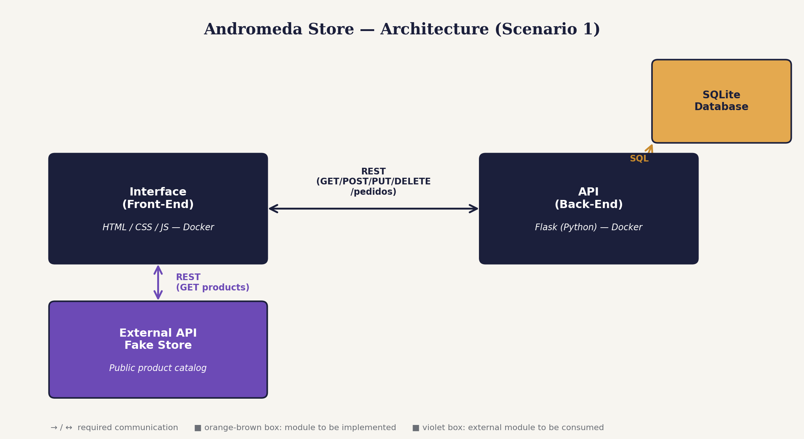

# Andromeda Store - API (Back-End)

A REST API built with **Flask** and **SQLite** responsible for managing
orders (`pedidos`) placed through the Andromeda Store interface. It is the
**Back-End** component of a small microservices-based e-commerce system: it
knows nothing about the product catalog or the external Fake Store API -
it only persists and manages the orders it receives.

## Architecture



- **API (this repository)**: exposes a REST interface for CRUD operations
  on orders, backed by a SQLite database.
- **Interface (Front-End)**: a separate repository/service that calls this
  API directly from the browser, and separately calls the external Fake
  Store API to list products.

## Routes

| Method | Endpoint | Description | Body (JSON) |
|--------|----------|-------------|-------------|
| GET | `/pedidos` | List all orders | — |
| POST | `/pedidos` | Create a new order | `titulo_produto`, `preco_produto`, `imagem_produto`, `quantidade` |
| PUT | `/pedidos/<id>` | Update an order's status/quantity | `status`, `quantidade` |
| DELETE | `/pedidos/<id>` | Remove an order | — |

Example order object returned by the API:

```json
{
  "id": 1,
  "titulo_produto": "WD 2TB Elements Portable External Hard Drive",
  "preco_produto": 64.0,
  "imagem_produto": "https://fakestoreapi.com/img/61IBBVJvSDL._AC_SY879_.jpg",
  "quantidade": 1,
  "status": "pendente",
  "data_criacao": "2026-08-22T02:06:11.434188"
}
```

## Getting started

### Prerequisites

- Python 3.12+ and `pip`, **or**
- [Docker](https://docs.docker.com/desktop/) to run it in a container

### Option 1 - Run locally

```bash
# Create and activate a virtual environment
python -m venv venv
venv\Scripts\activate        # Windows
source venv/bin/activate     # macOS/Linux

# Install dependencies
pip install -r requirements.txt

# Run the API
python app.py
```

The API will be available at **http://127.0.0.1:5000**. A `loja.db` SQLite
file is created automatically on first run.

### Option 2 - Run with Docker

```bash
docker build -t loja-api .
docker run -d -p 5000:5000 loja-api
```

## Project structure

```
loja-api/
├── app.py                    # Flask app: routes and server startup
├── models.py                  # SQLAlchemy model (Pedido) and database instance
├── requirements.txt           # Python dependencies
├── Dockerfile                 # Container definition
└── architecture-diagram.png   # System architecture diagram
```

## Notes

- CORS is enabled (`flask-cors`) so the interface, opened as a static file or
  served from a different origin/port, can call this API from the browser.
- The database file (`loja.db`) is created inside the container's filesystem
  and is **not persisted** between container runs unless a Docker volume is
  configured, each `docker run` starts with a fresh database.
